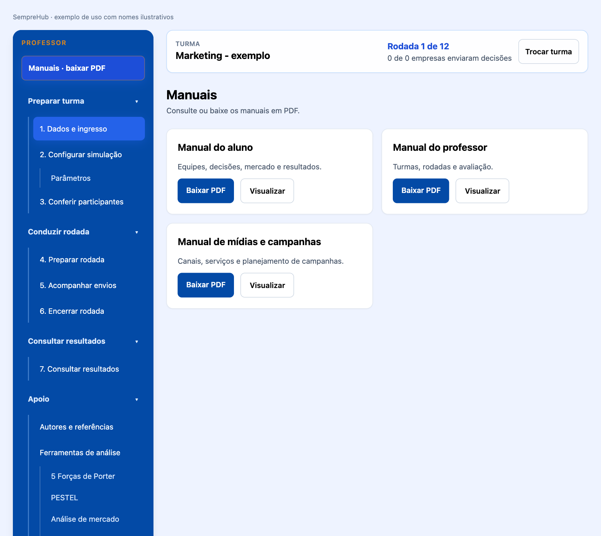
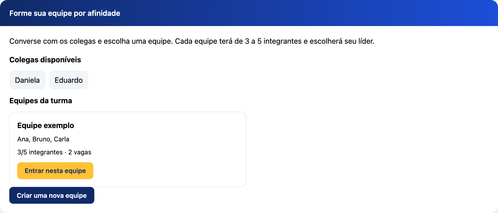
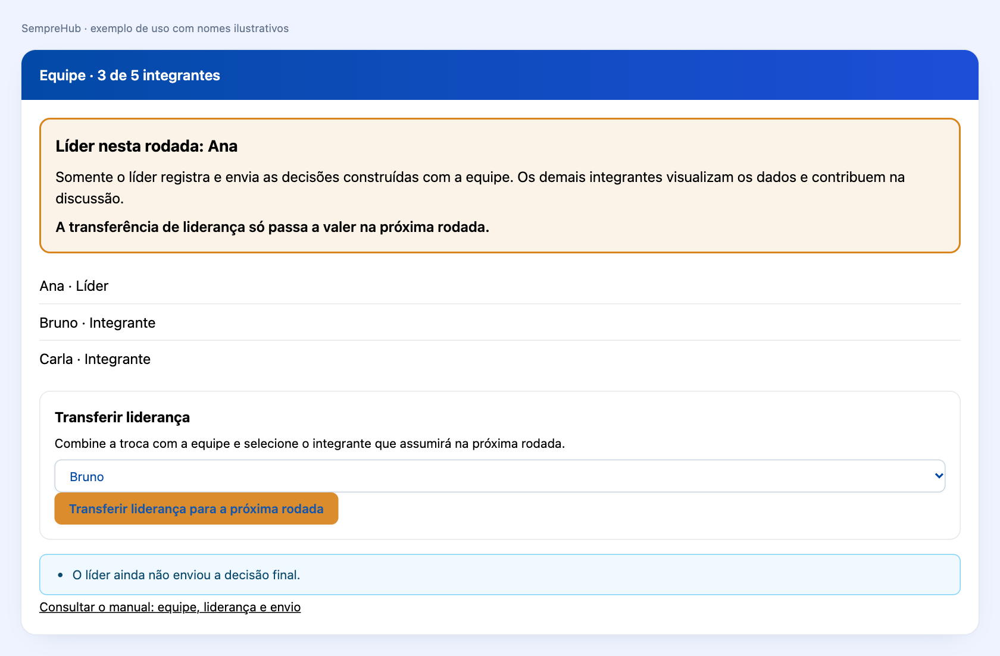
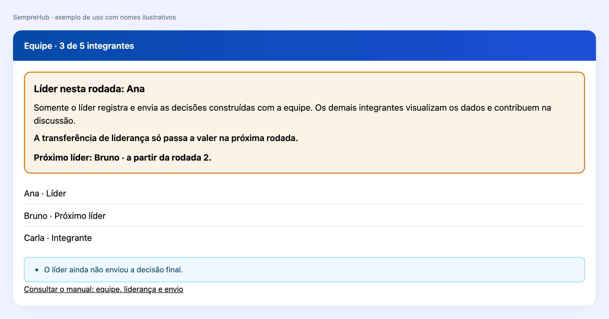
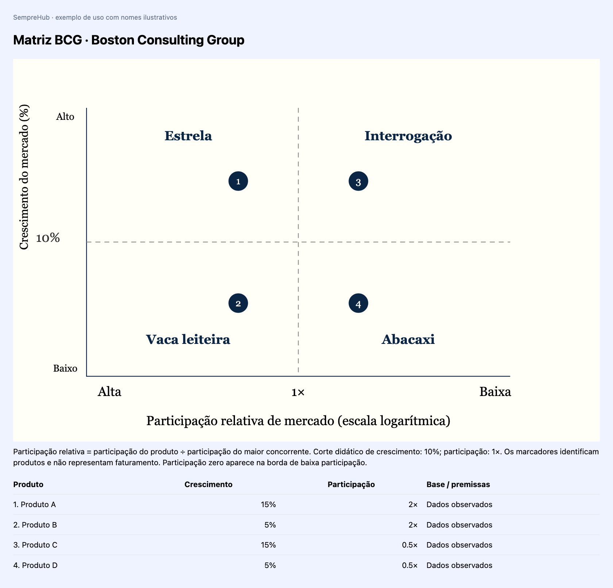

# SempreHub - Manual do professor

## Sobre o jogo

O SempreHub é um simulador educacional de negócios para estudantes do Ensino Médio e Superior. Em equipe, vocês administram uma empresa, interpretam o mercado e acompanham as consequências de suas escolhas ao longo de rodadas semanais que acompanham o calendário.

O jogo reúne seis áreas: Produção, Logística, Marketing, Recursos Humanos, Pesquisa e Desenvolvimento (P&D) e Finanças. Escolher um preço, contratar pessoas, comprar máquinas, investir em divulgação ou solicitar crédito modifica recursos, custos e possibilidades da empresa.

As equipes competem por clientes em um mercado compartilhado. O objetivo é aprender a analisar informações, discutir alternativas e justificar decisões. O resultado de uma rodada oferece elementos para rever a estratégia na seguinte.

Este é um ambiente de aprendizagem: os valores e os resultados são produzidos pela simulação a partir das regras e decisões registradas. As situações representam desafios que empresas enfrentam no mercado todos os dias.

Criado por: Prof Guandalini.

## Carta de apresentação

Olá, seja bem-vindo ao SempreHub.

O SempreHub foi criado para integrar conhecimentos de diversas áreas e aplicá-los à gestão de organizações que ingressam e atuam no mercado. A disciplina terá uma abordagem essencialmente prática: conceitos estudados em outras disciplinas serão utilizados na análise de cenários, na tomada de decisões e na avaliação dos resultados da empresa simulada.

O SempreHub funciona como um **ecossistema de negócios**. Ecossistema é um conjunto de participantes e atividades que se relacionam e dependem uns dos outros. No jogo, essa rede reúne estudantes, equipes, departamentos da empresa, clientes, fornecedores e concorrentes. Uma mudança em uma parte pode modificar as condições das demais.

Por exemplo: aumentar a produção exige materiais, capacidade e pessoas; a logística precisa entregar os produtos; o marketing influencia a procura; e as finanças precisam sustentar os pagamentos. Seus concorrentes também fazem escolhas e disputam os mesmos clientes. Por isso, nenhuma decisão deve ser analisada isoladamente.

As **decisões do simulador se baseiam em situações reais do mercado**. Definir preços, contratar funcionários, investir em tecnologia, planejar estoques e negociar crédito fazem parte da rotina de empresas de diferentes setores. Um preço pode atrair compradores e reduzir a margem; uma compra pode ampliar a capacidade e consumir caixa; um empréstimo pode financiar a operação e aumentar as despesas com juros. Esses desafios aparecem todos os dias no mercado.

No SempreHub, vocês experimentam essas relações em um ambiente educacional. Os resultados são simulados, conforme as regras do jogo e as escolhas registradas, e servem para estudar as consequências que decisões semelhantes podem ter em uma empresa.

Cada nova rodada semanal representa sete dias; turmas mensais históricas preservam sua periodicidade. Se uma escolha não produzir o resultado esperado, use os relatórios para identificar as causas, discutir o que poderia ter sido diferente e preparar a próxima decisão. Aprender também envolve reconhecer erros e ajustar a estratégia.

Espero que esta experiência ajude você a transformar conhecimento em análise, decisão e aprendizagem.

**Prof Guandalini**

## Calendário semanal e sazonalidade

Cada rodada semanal representa sete dias consecutivos, a partir da data de início definida automaticamente pelo servidor no horário de Brasília. Os meses seguem o calendário real: não se presume que todo mês tenha quatro semanas. A semana pode atravessar meses, trimestres e anos. O cabeçalho mostra suas datas. Como a rodada começa na data ativa da turma, os sete dias podem atravessar duas semanas ISO; nesse caso o cabeçalho mostra as duas, por exemplo "Semanas ISO 46–47/2026 · 14/11 a 20/11". O prazo real de entrega às 23:59:59 de Brasília é independente dessas datas simuladas.

### Início automático e preservação do histórico

Não é necessário preencher uma data de início. O calendário assume a data vigente em Brasília quando a turma inicia sua operação semanal e avança sete dias por rodada. Reabrir uma tela não muda a data inicial. Nas turmas mensais existentes, uma rodada com decisões salvas mantém seu contrato; a migração automática ocorre na próxima rodada livre, sem recalcular o passado. O prazo real de envio continua sendo definido pelo professor.

### MEI: cenário projetado para 2027 e 2028

A Lei Complementar nº 238, de 21/10/2026, publicou o cronograma de teto do MEI: R$ 110.000 em 2027 e R$ 140.000 a partir de 2028. Os efeitos têm datas específicas e a ampliação dos limites depende das condições orçamentárias do art. 3º. O cenário didático mantém identificação como Estimativa do Modelo porque não comprova essa condição nem substitui a apuração tributária legal. O limite de até dois empregados vale para todo MEI a partir de 1º/1/2027 (art. 10, II): a nova redação do art. 18-C da LC 123/2006 mantém a estrutura que já aplicava o limite de um empregado a qualquer MEI, e a condição orçamentária do art. 3º alcança apenas os limites de receita. Até 2026, o limite é de um empregado. O ano simulado orienta a seleção das regras. Fotografias antigas não são reescritas. Fonte primária: https://legis.senado.gov.br/norma/44276013/publicacao/44280206

### Registros de participação

As aberturas de abas internas são registradas com aluno, equipe, rodada e horário para acompanhamento pelo professor. Não são coletados textos digitados neste relatório. Registros começam na implantação: ausência de registro não comprova ausência anterior. Abertura de aba não comprova leitura nem qualidade da decisão e não gera nota automática. No painel docente, consulte Consultar resultados → Acessos dos alunos, filtrando por rodada e alternando participantes e abas visitadas.

### Painel semanal: bases e indicadores

Em Resultados → Painel semanal, selecione a semana ISO e seu ano, acompanhados das datas exatas dos sete dias. Não são janelas móveis: cada filtro corresponde a uma rodada encerrada. Rodadas mensais legadas continuam identificadas como mensais, sem redistribuição artificial. O professor consulta o mesmo painel, somente em leitura, nos detalhes da empresa → semanal.

Marketing e vendas, Pessoas, Produção e Logística aparecem separadamente. Na aba Bases informadas, somente o líder registra dados complementares; integrantes consultam. Valores ausentes ficam vazios, não são convertidos em zero. As bases não alteram decisões, notas, caixa ou demonstrativos consolidados. Cada indicador informa sua origem: Valor Calculado, Estimativa do Modelo, Dados informados pela equipe ou Dados indisponíveis. Dados informados não são auditados automaticamente na internet.

| Indicador | Base de cálculo e leitura |
| --- | --- |
| CAC semanal | Investimento atribuível / novos clientes faturados. Não confundir unidades vendidas com clientes únicos. No Startup, o motor disponibiliza sua estimativa quando não há bases informadas. |
| Conversão semanal | Pedidos faturados / leads ou visitantes × 100, da mesma coorte e período. Não misturar pedidos repetidos com aquisição de clientes. |
| CPL / CPC | Gasto com anúncios / leads ou cliques, respectivamente. O gasto deve corresponder ao mesmo conjunto de campanhas e à mesma semana. |
| Churn realizado | Clientes recorrentes cancelados / base recorrente inicial × 100. Startup usa clientes perdidos efetivos; empresas transacionais sem base recorrente não recebem churn inventado. |
| NPS | (Promotores − detratores) / total de respostas × 100. Notas 9–10 são promotores, 7–8 neutros e 0–6 detratores. Exige respostas efetivamente informadas. Não é eNPS. |
| Absenteísmo | Horas de ausência / horas contratadas da equipe × 100. Bases homogêneas; ausências não podem superar as horas contratadas. |
| Receita por colaborador | Receita registrada da rodada / funcionários ativos registrados. Não mede isoladamente esforço ou qualidade individual. |
| Horas extras | Horas extras planejadas por colaborador multiplicadas pelos funcionários registrados. Não representa horas efetivamente trabalhadas ou um ponto eletrônico. |
| OEE e refugo | Disponibilidade × performance × qualidade; refugo / produção realizada × 100. Sem operação aplicável, OEE é Não se aplica. |
| Produção planejada e realizada | Gráfico compara meta e produção registrada em unidades. Não pressupõe que toda produção foi vendida. |
| OTIF | Pedidos entregues no prazo e completos / pedidos entregues × 100, conforme convenção didática do motor. Emitir nota ou despachar no prazo não comprova entrega ao cliente no prazo. |
| Separação | Média em minutos informada para o intervalo aprovação → despacho. Não há rastreamento de bipagem ou emissão fiscal real nesta plataforma educacional. |
| Relação físico / registrado | Quantidades físicas e registradas comparáveis × 100. É uma relação de saldo; pode superar 100% e não substitui uma auditoria de acuracidade por item/SKU. |

Denominador zero ou base insuficiente gera Dados indisponíveis. Não há envio automático de pesquisa NPS a clientes reais nem integração automática com plataformas de anúncios, notas fiscais ou leitores de estoque neste módulo. A API autenticada permite registrar e consultar as bases; isso não constitui integração instalada com terceiros.

Referências técnicas verificadas: REICHHELD, Frederick F. The one number you need to grow. Harvard Business Review, dez. 2003. Disponível em: https://hbr.org/2003/12/the-one-number-you-need-to-grow. Acesso em: 15 out. 2026. PEPPERS, Don; ROGERS, Martha. Managing customer experience and relationships: a strategic framework. 3. ed. Hoboken: Wiley, 2016. DOI: 10.1002/9781119239833. Acesso em: 15 out. 2026. As fórmulas didáticas do simulador não são apresentadas como parâmetros empíricos extraídos dessas obras.

### Complementos auditados de métricas e metas

O painel mantém o mesmo calendário semanal. Em cada área, use Indicadores, Bases informadas ou Metas; na Produção, Plano x realizado abre o gráfico separado. Campos não preenchidos permanecem ausentes, não são convertidos em zero. É preciso salvar ou descartar uma edição antes de trocar a semana.

| Indicador complementar | Fórmula e origem |
| --- | --- |
| Aderência ao plano | Produção realizada / produção planejada × 100. Sem plano positivo, Dados indisponíveis. Pode superar 100%; produzir além da meta não comprova boa gestão do estoque. |
| Tempo médio de ciclo | Tempo total dos ciclos medidos, em minutos / ciclos concluídos da mesma unidade ou lote. Base informada, distinta do tempo de atravessamento de um pedido. |
| Turnover por desligamentos | Desligamentos efetivos / colaboradores no início × 100. Nas novas rodadas, o motor registra a base inicial e as saídas efetivas; no histórico sem essas bases, a equipe pode informá-las. Não substitui a taxa anterior de movimentação, que considera admissões e desligamentos. Pode superar 100% em períodos com admissões e saídas sucessivas. |
| Horas extras realizadas | Total informado para a equipe. Permanece separado das horas extras planejadas ou estimadas pelo motor. |
| Custo logístico por pedido | Custo logístico total informado / pedidos expedidos da mesma base. Inclua somente os custos e pedidos da semana analisada. |
| Custos registrados por pedido | Frete e armazenagem da DRE / pedidos despachados registrados no motor. É um custo parcial identificado; não presume que embalagens e outras despesas foram registradas. |
| Acuracidade por itens auditados | Itens ou SKUs sem divergência / itens ou SKUs auditados × 100. A conferência deve comparar o mesmo conjunto de itens. A relação entre saldos físicos e registrados continua disponível, mas não substitui esse índice de conformidade. |

CAC utiliza o investimento de aquisição da semana. CPL e CPC utilizam especificamente o gasto com anúncios, dividido por leads e cliques, respectivamente. Um gasto geral de marketing não é automaticamente tratado como gasto de mídia: sem esse dado específico, CPL e CPC exibem Dados indisponíveis.

O OTIF do simulador continua contando pedidos que atendem simultaneamente às condições de prazo e completude, com tratamento de sobreposição de falhas. Não se calcula automaticamente multiplicando percentuais marginais On-Time e In-Full: os grupos de pedidos podem se sobrepor de formas diferentes. A convenção didática do motor continua identificada; não houve reprocessamento do passado. Referência de conferência: ASCM. SCOR Digital Standard, RL.3.1. Disponível em: https://scor.ascm.org/performance/reliability/RL.3.1. Acesso em: 15 out. 2026.

Na aba Metas, defina o alvo e o limite de alerta. Para indicadores em que maior é melhor, o alvo deve ser maior ou igual ao alerta; para aqueles em que menor é melhor, o alvo deve ser menor ou igual ao alerta. Exemplos: CAC até R$ 10,00, alerta até R$ 20,00; conversão de pelo menos 80%, alerta a partir de 60%. A igualdade pertence à faixa correspondente. O painel apresenta texto e cor: Dentro da meta (verde), Em alerta (amarelo), Fora da meta (vermelho) ou Sem dados (neutro). Sem meta configurada, não existe sinalização presumida. A equipe pode remover uma meta.

As metas são referências de comparação escolhidas pela equipe para uma semana registrada, podendo ser configuradas após o fechamento. Não constituem comprovação de meta fixada antecipadamente e não alteram notas, decisões ou demonstrações contábeis. Um sinal verde representa o atendimento à referência escolhida, não uma garantia de saúde da empresa. Somente o líder edita; integrantes e professor consultam. As bases e metas têm persistência independente dos snapshots do motor.

### Planejar antes da data comercial

Se a simulação começa em 15 de outubro, o Dia das Crianças já passou. O Natal está aproximadamente dez semanas à frente. A equipe deve avaliar a procura esperada, a capacidade e o estoque antes de contratar, comprar ou anunciar. Comprar máquina em uma semana só libera sua capacidade na rodada seguinte. Aumento esperado de procura não garante vendas nem obriga investimento: preços, concorrentes, disponibilidade e decisões da equipe continuam afetando o resultado.

### Sazonalidade por setor: replicação do ajuste do IBGE

Cada rodada corresponde a um mês de operação. A procura de cada mês é multiplicada pelo fator sazonal do setor, calculado pela **replicação do ajuste sazonal X-13ARIMA-SEATS** que o IBGE aplica à Pesquisa Mensal de Comércio (PMC, tabela 8882, índice de volume sem ajuste sazonal). A replicação segue as especificações publicadas na Nota metodológica IBGE 01/2022: modelo ARIMA de cada série, outliers e efeitos de calendário (Carnaval, Páscoa e Corpus Christi). Colchões e Móveis usam a série "Móveis e eletrodomésticos"; Vestuário e Mochilas, "Tecidos, vestuário e calçados"; Bicicletas e Pet Shop, "Outros artigos de uso pessoal e doméstico".

As datas comemorativas (Dia das Mães, Black Friday, Natal etc.) aparecem apenas como aviso: o efeito delas já está no fator do IBGE e não é contado duas vezes. A série de vestuário é ajustada pelo IBGE de forma aditiva; o efeito em pontos de índice é convertido em percentual pelo nível médio da série ajustada nos 12 meses anteriores, e a tela informa essa conversão. Os fatores são previstos para 24 meses e revistos uma vez por ano, quando a PMC publica um ano completo novo; cada turma mantém a edição vigente no início do jogo.

Use a indicação como pergunta de gestão: há estoque, caixa, pessoas e campanha para atender a procura do mês? Preço, concorrência e disponibilidade continuam afetando o resultado.

### Consequências nos departamentos

| Área | O que avaliar na semana |
| --- | --- |
| Marketing | Preço, público, campanha e posicionamento antes do pico; a campanha não garante conversão. |
| Produção e P&D | Capacidade proporcional ao período, matéria-prima, refugo, qualidade e investimentos antecipados. |
| Recursos humanos | Contratação, salários, benefícios, treinamento e horas extras compatíveis com a operação. Não há contratação automática por sazonalidade. |
| Logística | Entregas, estoque e pressão de frete; pedidos não atendidos continuam afetando OTIF. |
| Finanças | Capital de giro, compras, recebimentos, juros e caixa suficientes para financiar a preparação. |

### Valores de referência e valores da rodada

Salário e benefício por funcionário continuam sendo referências mensais; a despesa semanal é proporcional aos dias. Custos fixos, capacidade industrial, produtividade, armazenagem, depreciação, DAS de referência e serviços recorrentes da Startup também são proporcionais. Para cada dia usa-se 1 dividido pela quantidade de dias daquele mês. Uma semana inteiramente em outubro corresponde a 7/31 do valor mensal; uma semana entre fevereiro e março soma as frações dos dois meses. Juros e crescimento usam taxas equivalentes compostas; churn usa sobrevivência equivalente. Quantidades de produção, compras e novas contratações são escolhas da semana, não valores mensais divididos automaticamente. Investimentos, rescisões, treinamento e pagamentos pontuais não são divididos outra vez.

A capacidade da nuvem representa clientes simultâneos e não é dividida por quatro. Mensalidades e custos recorrentes por cliente são proporcionais; MRR continua sendo a receita mensal equivalente, enquanto a DRE mostra a receita do período. O alvo mensal didático de manutenção de R$ 1.000 é proporcional à semana; ausência de manutenção acumula desgaste proporcional ao tempo. A referência salarial usada no eNPS permanece mensal, evitando comparar salário semanal com salário mensal.

Prazos de compra e venda são expressos em semanas nas turmas semanais. PMR e PMP usam sete dias, com saldos originados na própria rodada; no histórico mensal mantêm a convenção de 30 dias. Para classificação didática, o curto prazo semanal abrange 52 rodadas (364 dias). As competências fiscais anuais usam o ano de encerramento da semana; uma semana que cruza o ano é atribuída a esse ano para os controles anuais simplificados. Isso não representa apuração tributária legal.

### DRE e balanço são consultas diferentes

A aba DRE abre o demonstrativo completo da rodada. As visões mensal e trimestral consolidam somente semanas registradas com datas: cada linha é rateada por dia em centavos, sem duplicar uma semana que atravessa competências. Períodos ainda incompletos são apresentados como parciais. O balanço é uma fotografia patrimonial no fim da rodada e não deve ser somado entre semanas. Aportes e empréstimos continuam fora da receita; cheque especial é passivo, e o caixa assinado permanece no fluxo e no cabeçalho.

### Histórico mensal preservado

Turmas anteriores migram automaticamente para semanas na primeira rodada aberta sem decisões salvas. Uma rodada mensal já planejada mantém suas regras até o fechamento. Os resultados anteriores não são recalculados nem redistribuídos por datas inventadas. A ativação é prospectiva e não pode ser reposicionada. Obrigações futuras sem datas absolutas herdadas do modelo mensal são convertidas pela convenção de 30 dias por mês, arredondando para a semana de vencimento seguinte; essa aproximação não altera snapshots passados. Resultados novos registram a versão do motor e o calendário usado — a edição sazonal por setor é identificada como `3.2.0-seasonal-sector-calendar`. Exemplos mensais neste manual continuam sendo referências mensais ou descrições do histórico, e não uma cobrança integral por semana.

## A história e o conceito da logomarca SempreHub

**Autoria e criação: Professor Guandalini.** O nome, a marca e a identidade visual do SempreHub foram idealizados e criados pelo Professor Guandalini. A marca aproxima o ambiente corporativo da conexão das redes modernas e representa uma metodologia de aprendizagem integrada, voltada ao Ensino Médio e Superior.

**SEMPRE** expressa constância, aprendizado contínuo e resiliência. Empreender é um ciclo de tentativas, análise de resultados, ajustes e evolução. **HUB** identifica um centro conector: estudantes, departamentos, gestão e mercado competitivo se encontram em um mesmo ecossistema.

### O símbolo: a rede de gestão

Os nós periféricos, em azul e ciano, representam os seis departamentos vitais: Pesquisa e Desenvolvimento (P&D), Produção, Logística, Marketing, Recursos Humanos (RH) e Finanças. Eles mostram uma empresa cujas áreas trabalham em conjunto.

As linhas conectoras representam a interdependência das decisões. Alterar o preço no Marketing pode mudar a demanda e o faturamento nas Finanças. Aumentar a Produção modifica a necessidade de materiais, de pessoas e de capacidade logística. Nenhuma decisão é isolada.

Os dois núcleos em Laranja Ouro representam a tomada de decisão do estudante e o motor de Inteligência Artificial que participa do processamento do mercado. A ligação entre eles expressa a resposta do sistema às escolhas das equipes. Na orientação ao aluno, o foco está na análise crítica, na decisão e nas consequências para a empresa.

### As cores e seu significado

**Azul Royal (#034AA6) e Azul Médio (#0762D9): rigor acadêmico.** Associam a identidade ao ambiente corporativo, à credibilidade e à seriedade pedagógica. A intenção visual é comunicar confiança e valorizar a aprendizagem empresarial.

**Ciano/Turquesa (#0AADBF): inovação e fluidez.** Relaciona a marca à tecnologia e à navegação intuitiva. Aproxima o universo da gestão de estudantes iniciantes e reforça uma experiência leve, organizada e acessível.

**Laranja Ouro (#D9851E): núcleo de decisão e geração de valor.** Destaca criatividade, iniciativa e competitividade. Na rede, orienta o olhar para os pontos centrais onde as decisões e suas consequências se conectam.

Na logomarca, os gradientes conectam as tonalidades azuis, cianas e douradas. O fundo branco valoriza o contraste da rede e do nome e organiza uma apresentação limpa para os conteúdos do manual.

### A tipografia: identidade corporativa acessível

A escrita sem serifas, com formas modernas e suaves, expressa democratização do conhecimento. O SempreHub foi concebido para estudantes de diferentes áreas, como Saúde, Humanas e Exatas. A organização visual ajuda a localizar decisões e compreender relações entre departamentos.

### Como ler a marca na prática

Ao observar a rede, lembre-se de verificar as consequências de cada escolha nas outras áreas. A marca traduz o propósito pedagógico do simulador: discutir, decidir, acompanhar resultados e aprender com os ajustes. Uma interpretação correta das ferramentas pode apoiar decisões melhores; resultados dependem das escolhas da equipe e do mercado simulado.

## Operação docente e calendário

No menu lateral, abra **Encerrar rodada**. Escolha a data em **Data limite da rodada** e clique em **Salvar prazo**. O bloqueio ocorre às **23:59:59 de Brasília**, exclusivamente na data configurada para aquela rodada. Antes desse instante, rascunhos e envios finais continuam permitidos. Sem prazo, o encerramento é manual.

Antes de orientar os alunos a iniciar cada rodada, confira o alerta de configuração no painel. Quando não houver data limite salva, aparecerá **Configuração pendente: rodada sem data limite**. Clique em **Configurar prazo da rodada** para abrir o campo correspondente. O aviso desaparece após salvar a data. O prazo anterior não é reutilizado; manter a rodada sem prazo é permitido, mas exige encerramento manual pelo professor.

O sistema encerra a rodada automaticamente quando o prazo vence, inclusive se ninguém estiver conectado. O professor também pode usar **Forçar Fechamento Imediato da Rodada**, com confirmação. Rascunhos existentes são preservados e processados como fechamento automático; sem decisão, o motor mantém as escolhas recorrentes anteriores e zera ações pontuais. Esses casos não equivalem a entrega final voluntária da equipe.

O motor preserva os cálculos da simulação, atualiza caixa, estoque e participação e avança a rodada uma única vez. No próxima rodada, o líder volta a editar e o professor configura um novo prazo. O mecanismo de inteligência de mercado recebe os dados estruturados para preparar análises e relatórios; suas fontes e controles ficam no painel docente. Projeções são identificadas e dados ausentes não são apresentados como fatos confirmados.

## Navegação: escolha à esquerda, trabalhe à direita

O menu lateral é o ponto de partida. Suas categorias e submenus aparecem abertos inicialmente. Você pode recolher uma categoria para organizar a tela e abri-la novamente quando precisar. O submenu selecionado fica destacado, e o conteúdo aparece no painel à direita. Em telas estreitas, o menu permanece disponível acima do conteúdo e possui rolagem própria.

1. Localize no menu o assunto desejado.
2. Clique uma vez no submenu. Não é necessário abrir outra janela para tomar decisões.
3. Confira o título do painel à direita antes de alterar qualquer valor.
4. Ao terminar, salve o rascunho, avance ou envie conforme a etapa.
5. Para estudar, abra **Manuais - baixar PDF**. Use **Visualizar** para consultar ou **Baixar PDF** para guardar uma cópia.

Os campos de decisão mostram pendências, como **Falta tomar esta decisão** ou **Falta confirmar esta decisão**. Eles não substituem este manual. A confirmação de uma área significa que a equipe conferiu todos os seus campos, incluindo a decisão de manter em zero ações opcionais. Um aviso de campo vazio continua pendente mesmo depois de marcar a revisão. Os estados do menu referem-se à última versão salva; valores ainda não salvos precisam ser registrados.

Versão 3.5 - outubro de 2026

Guia para preparar turmas, acompanhar equipes, conduzir rodadas e avaliar a aprendizagem. As imagens de uso apresentam nomes ilustrativos.

## 1. Crie a turma e controle o ingresso

1. Entre com sua conta de professor e selecione **Criar turma**.
2. Defina um nome livre para a turma. Não existe padrão obrigatório: o aluno seleciona exatamente o nome que você cadastrar.
3. Escolha o modo de jogo, cenário, rodadas e parâmetros antes de criar empresas.
4. No painel, abra **Dados e ingresso** e marque **Disponível para ingresso dos alunos**.
5. Informe à sala o nome da turma. Não é necessário divulgar código de turma ou convite de equipe.

Você pode ocultar outras turmas ou liberar somente uma. A visibilidade controla novos ingressos; alunos já vinculados continuam acessando sua turma. O vínculo é único: outra matrícula depende de autorização do professor da turma de origem.

A quantidade de alunos não precisa ser informada. Eles se cadastram e entram por conta própria. O professor não cadastra participantes nas equipes como procedimento normal.

## 2. Formação por afinidade e distribuição dos alunos restantes

Os alunos veem colegas disponíveis e equipes existentes na turma. Escolhem seus grupos por afinidade, com **3 a 5 integrantes**. A empresa pode começar com menos integrantes durante a formação, mas precisa atingir o mínimo para escolher o líder e concluir uma rodada.

Depois de perguntar em sala se todos conseguiram entrar nas equipes:

1. Confira a lista **Alunos sem equipe** no painel de ingresso.
2. Se necessário, organize novas equipes para garantir vagas.
3. Clique em **Encerrar formação e distribuir alunos sem equipe**.
4. Confira a mensagem com os alunos e suas equipes de destino.

O programa distribui aleatoriamente os alunos já cadastrados naquela turma, usando somente vagas em equipes com pelo menos três integrantes. Nenhuma equipe ultrapassa cinco. Se o total de vagas for insuficiente, a operação é bloqueada sem distribuição parcial.

O encerramento impede novas entradas e criação de equipes. Antes de fechar a primeira rodada, você pode usar **Reabrir formação** para corrigir a organização. Depois do início das rodadas, essa reabertura não fica disponível.

### Exceções e troca de turma

Em **Autorizar troca de turma ou inclusão excepcional**, selecione o aluno e registre uma justificativa. A inclusão manual atende impedimentos alheios ao aluno e usa uma equipe com vaga da mesma turma. Alunos que já estão em uma equipe não são duplicados.

Para autorizar troca, escolha uma turma de destino disponível para ingresso. O aluno passa a poder selecionar esse destino; a autorização não o matricula automaticamente. A troca é consumida uma vez e preserva o histórico. Se o aluno for líder de uma equipe ativa, ele precisa transferir a liderança e aguardar a próxima rodada antes de trocar de turma. Sua saída pode deixar a equipe de origem abaixo do mínimo; confira a composição.

## 3. Liderança e permissões

A equipe escolhe o líder inicial depois de ter três a cinco integrantes. Cada aluno registra sua escolha. Quem recebe mais da metade das escolhas assume a liderança. Quem criou a empresa não é automaticamente líder nas novas equipes.

**O líder registra, salva e envia; os demais visualizam e contribuem na discussão.** Não há exigência de confirmação individual de cada integrante. As alterações e o responsável por cada envio ficam registrados.

O líder pode escolher outro integrante e clicar em **Transferir liderança para a próxima rodada**. A tela destaca o próximo líder e a rodada de vigência. A permissão não muda na rodada atual: a transferência é efetivada somente depois do fechamento. Há uma transferência programada por rodada; não existe transferência para depois da última rodada.

Para manter a continuidade, equipes existentes antes desta versão mantêm seu responsável anterior como líder. Os registros de confirmações das versões anteriores também são preservados para consulta histórica.

## 4. Prepare mercado e acompanhe as decisões

Em **Preparar rodada**, defina setor, tipo de comércio e quantidades de notícias, análises e produtos. Revise a edição antes de publicá-la. Os alunos consultam o conteúdo disponível da turma e as condições de concorrência do simulador.

SWOT, Porter, PESTEL e concorrência usam pesquisa atual e informações registradas da empresa. O painel docente permite consultar diagnósticos, datas e fontes de pesquisa. Informações não confirmadas são indicadas como projeções com premissas; não devem ser apresentadas como fatos ocorridos.

A análise de concorrência cobre perfil, localização e alcance, porte e participação, portfólio, qualidade e diferenciais, preços, pagamento, promoções, canais, presença digital, atendimento e reputação. Quando não existe base suficiente para um concorrente real, o sistema pode usar um concorrente de referência explicitamente projetado.

O aluno não recebe decisões prontas. **BCG, segmentação e interpretação financeira são responsabilidade da equipe.** Os alunos consultam os indicadores e demonstrativos calculados para tomar decisões. Não há campo de análise financeira escrita obrigatório; textos registrados anteriormente permanecem no histórico.

## 5. Envio final e fechamento da rodada

O aluno percorre produtos e marketing, ferramentas e segmentação, finanças, produção e logística quando aplicável. O líder pode guardar o trabalho em **Salvar rascunho completo** ou **Salvar e ir para [nome da próxima área]**.

**Rascunho não é entrega.** O envio final só ocorre quando todas as informações exigidas estiverem presentes. A mensagem de bloqueio indica as pendências.

O programa exige revisão das áreas aplicáveis, mixes completos, diretriz estratégica, segmentação, BCG de todos os produtos. Orçamentos de campanha são exigidos quando o serviço não possui custo público validado. Ações opcionais podem permanecer em zero.

1. Acompanhe **Envios** e as pendências de cada equipe.
2. Confira se todas as equipes têm entre três e cinco integrantes e líder definido.
3. Confira os envios finais. O fechamento automático ou forçado também processa registros pendentes conforme a regra de calendário.
4. Confirme o fechamento manual quando necessário; os eventos são sorteados pelo sistema.
5. Compare resultados e hipóteses com a turma antes da próxima rodada.

O fechamento calcula o mercado compartilhado, custos, produção e finanças; preserva os registros e avança a rodada. Também efetiva as transferências de liderança previstas para a nova rodada. Depois do envio final, o líder não pode editar a decisão até o próxima rodada.

## 6. BCG e consequências das escolhas

A matriz da Boston Consulting Group usa crescimento no eixo vertical e participação relativa no horizontal. Alta participação fica à esquerda: Estrela no alto à esquerda e Vaca leiteira embaixo; Interrogação no alto à direita e Abacaxi embaixo. O corte didático de crescimento é 10%, e o de participação é 1x. O eixo horizontal é logarítmico.

Os alunos informam crescimento, participação, classificação e base dos dados. Projeções exigem premissas. A participação relativa é a participação do produto dividida pela participação do maior concorrente. Marcadores numerados identificam produtos; não indicam faturamento.

Interpretações se traduzem em escolhas de preço, posicionamento, público, produção e investimento. Coerência estruturada entre SWOT, BCG, segmentação e mix pode afetar a conversão comercial. Outros efeitos são econômicos: excesso de estoque imobiliza caixa, crédito gera juros, expansão aumenta capacidade e custos, e P&D afeta qualidade. O sistema não pune textos livres arbitrariamente nem garante lucro por uma classificação correta.

## 7. Máquinas, crédito e demonstrativos

A vida útil contábil padrão de máquinas é **24 meses**, configurável antes da entrada das empresas. O aluno consulta o valor vigente na Produção e a condição de cada máquina no painel operacional. Depreciação reduz o valor contábil; a máquina não é removida automaticamente ao fim da depreciação.

Novas compras são opcionais a partir do rodada 3, com pagamento no mês da compra e ativação na rodada seguinte. Funcionários, horas extras, insumos e máquinas impõem limites conjuntos à capacidade. Horas extras usam a premissa didática de até 40 horas mensais de referência por funcionário, proporcionais aos dias da semana, adicional de 50%, salário/220 e encargos.

A DRE mostra resultado, a DFC mostra dinheiro, e o balanço mostra ativos e obrigações. A discussão da equipe deve considerar margem, caixa, recebimentos, pagamentos, estoques e capital de giro. Solicitar crédito exibe aviso de custo alto e risco ao lucro e caixa. Em Startup, aporte de investidores não entra como receita comercial e pode diluir os fundadores.

### Pró-labore, encargos legais e custo da equipe

**Jornada do fundador.** O fundador só integra a operação quando a equipe registra pró-labore. A fração da jornada que ele dedica é o pró-labore da rodada dividido pelo salário de referência júnior da turma no mesmo período, com limite de uma jornada; abaixo da referência, o resultado avisa a dedicação parcial. O salário de referência é parâmetro didático da turma. Fundamentação: DORNELAS, José. Empreendedorismo: transformando ideias em negócios. 9. ed. São Paulo: Atlas, 2023, cap. 6 (pró-labore como retirada dos sócios, custo fixo e dedicação parcial); SLACK, Nigel; BRANDON-JONES, Alistair; BURGESS, Nicola. Administração da produção. 10. ed. São Paulo: Atlas, 2023, cap. 11 (capacidade medida pelas horas de trabalho disponíveis).

**Custo do empregado CLT.** O motor aplica sobre o salário mensal um fator que segue o método de MARTINS, Eliseu. Contabilidade de custos. 12. ed. Barueri: Atlas, 2025, cap. 11: o custo anual corresponde a 12 salários, 13º e um terço de férias (13,333 salários), acrescido dos encargos legais, e é distribuído pelos 11 meses efetivamente trabalhados.

| Regime | Encargos considerados | Fator |
|---|---|---|
| Simples Nacional | FGTS 8% (contribuição patronal incluída no DAS) | 1,3091 |
| MEI | FGTS 8% e patronal de 3% | 1,3455 |
| Lucro Presumido | FGTS 8%, patronal 20%, risco de acidente 2% e terceiros 5,8% | 1,6461 |

Bases legais (texto compilado do Planalto, consultado em 14/11/2026): Lei 8.036/1990, art. 15 (FGTS); Lei 8.212/1991, art. 22, I e II (patronal e risco de acidente); LC 123/2006, art. 13, VI e § 3º (patronal no DAS e dispensa de terceiros no Simples) e art. 18-C, § 1º, III (3% do MEI). O grau de risco médio (2%) é parâmetro didático, pois a lei prevê 1%, 2% ou 3% conforme a atividade. Os 5,8% de terceiros seguem o exemplo de Martins; as leis específicas de cada contribuição não foram conferidas nesta revisão. O modelo usa o Anexo I do Simples; o Anexo IV, que recolhe a patronal fora do DAS, não está modelado.

**Encargo sobre o pró-labore.** No Lucro Presumido, a empresa soma 20% de contribuição patronal sobre o pró-labore (Lei 8.212/1991, art. 22, III); a DRE mostra a linha "encargos sobre pró-labore". No Simples e no MEI essa contribuição está no recolhimento unificado (LC 123/2006, art. 13, VI). A contribuição do próprio sócio (11%, após a dedução do art. 30, § 4º, da Lei 8.212/1991) é descontada do pró-labore (Lei 10.666/2003, art. 4º) e não é custo da empresa. O sócio não recebe FGTS, 13º nem férias, por não ser empregado; por isso, mesmo com a mesma retirada, custa menos que um funcionário.

## 8. Avaliação automática e auditoria

O relatório pedagógico calcula **nota de desempenho de 0 a 10** a partir da pontuação ponderada do simulador. Ela é provisória enquanto houver rodadas e final ao encerrar a simulação. Os critérios incluem lucro, patrimônio, satisfação quando disponível e entrega das decisões; critérios sem dados têm pesos redistribuídos.

No novo fluxo de equipes, um envio válido pelo líder comprova a entrega da equipe. Os demais alunos não perdem pontuação por não confirmar individualmente. Acessar o sistema comprova acesso, não aprendizagem ou contribuição efetiva; use a discussão e a justificativa das decisões para sua devolutiva pedagógica.

Consulte resultados, demonstrativos, histórico de liderança, decisões e diagnósticos por empresa e rodada. Exporte os relatórios quando precisar registrar a avaliação. A decisão de incorporar essa nota à avaliação formal da disciplina continua sob responsabilidade do professor.

## 9. Primeiro uso do professor, passo a passo

1. Crie ou acesse sua conta de professor e abra sua turma.
2. Em **Dados e ingresso**, confira o nome livre da turma e a disponibilidade para ingresso. Informe aos alunos o nome que aparece na tela. Não há necessidade de informar a quantidade de alunos nem distribuir códigos como procedimento normal.
3. Em **Configurar simulação**, escolha modelo e parâmetros antes de criar empresas. Confira caixa, rodadas, salário, crédito, concorrência e condições do modelo. Registre as premissas didáticas que explicará em sala.
4. Em **Conferir participantes**, acompanhe inscrições, grupos e líder escolhido. Pergunte se todos conseguiram entrar. Use a distribuição de alunos sem equipe apenas quando existirem vagas em equipes com pelo menos três integrantes.
5. Em **Preparar rodada**, escolha o setor e prepare o conteúdo. Revise dados, produtos, custos e projeções antes de publicar. Sem edição publicada, o aluno não consegue completar o catálogo correspondente.
6. Em **Acompanhar envios**, confira as entregas finais. Um rascunho não comprova entrega. Uma equipe sem líder ou abaixo do mínimo precisa de organização antes de fechar a rodada.
7. Em **Encerrar rodada**, confira pendências, confirme o fechamento e acompanhe os resultados à direita. Essa ação calcula a rodada e pode efetivar transferências de liderança.
8. Em **Consultar resultados**, compare empresas, demonstrativos e avaliação. Em **Manuais - baixar PDF**, consulte todos os materiais ou indique aos alunos o capítulo adequado.

## 10. Roteiro para orientar principiantes

Apresente a navegação antes de discutir estratégia. Demonstre uma decisão com dados ilustrativos: localizar o submenu, interpretar a informação, escolher um valor, salvar rascunho, confirmar a área e enviar. Explique a diferença entre uma decisão opcional em zero e uma etapa ainda não conferida.

Os avisos junto aos campos indicam pendências, e não dão a solução nem explicam o conceito. A fundamentação fica nos manuais. Oriente o aluno a localizar o assunto no sumário e pedir ajuda quando não compreender o dado. O manual do aluno apresenta exemplos de preço, BCG, crédito, produção e análise financeira.

Um início possível é perguntar: quem é o público; o que será oferecido; por que compraria; quanto a equipe pretende vender; qual capacidade consegue atender; e quanto dinheiro será necessário antes de receber as vendas. Essas perguntas organizam a discussão sem substituir as decisões.

## 11. Checklist antes de cada fechamento

- A edição de mercado está publicada e foi conferida.
- As equipes possuem composição válida e líder definido.
- Os alunos que ficaram sem equipe foram atendidos sem ultrapassar cinco integrantes.
- As decisões estão enviadas, não apenas salvas como rascunho.
- As etapas aplicáveis, mixes, BCG e segmentação foram registrados.
- A turma conhece as consequências de crédito, produção, pessoas e campanhas.
- Transferências de liderança têm vigência clara na próxima rodada.

Se houver bloqueio, identifique a equipe e a pendência e peça a correção. O fechamento forçado ou automático processa rascunhos preservando seus valores, mas identifica esses registros como automáticos. Oriente a entrega final para evitar que escolhas ainda incompletas afetem o negócio. Uma alteração excepcional de participante exige justificativa e registro.

## 12. Interpretação de relatórios e nota

Use a DRE para discutir resultado, a DFC para discutir dinheiro e o balanço para discutir a posição financeira. Receita alta com caixa pressionado pode sinalizar prazos, estoque, custos ou investimento. Compare tendências entre rodadas; um resultado isolado não explica sozinho toda a aprendizagem.

A nota automática de zero a dez resume critérios de desempenho definidos pelo simulador. Confira os critérios e pesos efetivamente exibidos no relatório pedagógico; não atribua uma regra diferente por suposição. A entrega pelo líder conta para a equipe. Histórico de acesso não prova contribuição intelectual.

**Exemplo de devolutiva:** peça à equipe que explique por que tomou crédito e por que aumentou a produção. Compare justificativa, custo de juros, capacidade e vendas realizadas. Discuta uma alternativa para a rodada seguinte sem preencher a decisão por eles.

Use pesquisa atual, fontes e premissas para revisar os diagnósticos. Um dado confirmado, uma interpretação e uma projeção têm naturezas diferentes. A ausência de fonte não autoriza tratar uma estimativa como fato. A interpretação financeira e a segmentação continuam responsabilidade dos alunos, sem exigência de texto financeiro para envio.

### Relatório gerencial automático

Ao encerrar a rodada, o sistema grava para cada empresa um relatório gerencial com resultado comercial, DRE, fluxo de caixa e balanço em seções separadas, e o disponibiliza aos alunos na área de relatórios. O relatório não depende da integração com IA: quando ela está configurada, acrescenta uma narrativa; se estiver indisponível ou falhar, o relatório determinístico é gravado do mesmo modo. Quando um indicador mostra desempenho fraco, o relatório indica a leitura correspondente (obra e capítulo), apenas a partir de um catálogo de obras conferidas no acervo; uma falha sem obra conferida não recebe indicação presumida.

## 13. Problemas frequentes e respostas de orientação

**Aluno não vê a turma:** confira disponibilidade, rodada de ingresso, encerramento da formação e vínculo anterior. **Aluno não edita:** confira o líder vigente. **Transferência não ocorreu:** veja a próxima rodada indicada; agendar não muda a permissão atual. **Envio bloqueado:** consulte a pendência específica. **Sem vagas para distribuição:** organize vagas antes de repetir; não force equipes acima do limite.

Se o aluno mudou de turma com autorização, confira a composição da origem. Se a tela mostra versão antiga, peça atualização da página. Se os parâmetros não podem ser alterados, confira a etapa e as empresas já criadas; não prometa mudança retroativa de resultados.

Para retomar uma aula, abra o menu lateral, confira a rodada e use a última versão registrada. Consulte o histórico antes de corrigir uma situação: quem enviou, qual versão, qual rodada e qual justificativa de alteração.

## Versionamento e preservação dos resultados

O relatório pedagógico identifica a versão do motor por rodada: 1.0.0-legacy nos resultados históricos sem versão registrada e 2.0.0-deterministic-indicators nos novos cálculos. A identificação do legado ocorre na leitura, sem regravar os resultados. Não compare regras diferentes como se fossem idênticas.

Resultados antigos não são recalculados. Valores registrados permanecem visíveis; campos novos sem registros aparecem como Dados indisponíveis, sem criar um zero artificial. Na primeira rodada calculada pelas novas regras, os parâmetros operacionais começam com risco zero, performance de 100% e qualidade esperada de 98%, preservando caixa, estoques, dívidas e máquinas existentes. Nas rodadas seguintes, o desgaste segue seu histórico operacional.

A nota automática de 0 a 10 mantém seus critérios e pesos. Empréstimos e aportes não são receita da DRE. A reclassificação de caixa negativo em cheque especial não muda o patrimônio líquido por si só; despesas e juros efetivamente reconhecidos continuam afetando o resultado e a avaliação.

## Acesso aos manuais por perfil

Os PDFs exigem autenticação no servidor, inclusive quando a URL é aberta diretamente. O aluno acessa os manuais do aluno e de mídias; o professor acessa todos. Use os botões Visualizar ou Baixar PDF dentro do menu lateral. Sem sessão válida, entre novamente. Não há menu de manuais na página pública de abertura.

## Indicadores: referência para orientação das equipes

Os indicadores estão nos submenus de Resultados: Liquidez, Marketing, Finanças, Recursos Humanos, Produção e Logística. Consulte o valor e a rodada na tela; use este capítulo para compreender o que ele representa. A equipe deve comparar períodos, identificar causas, discutir alternativas e registrar suas próprias decisões. Ler um indicador não altera o resultado: as escolhas de preço, produção, investimento, pessoas, crédito e entrega é que afetam a empresa. Nenhum indicador isolado garante lucro.

Um traço significa que não há dados suficientes ou que o denominador é zero, nunca um resultado igual a zero. O simulador apresenta apenas valores que consegue sustentar com seus registros; exemplos do manual não são resultados da sua empresa. Todos os valores pertencem à simulação.

### Liquidez e segurança financeira

**Liquidez Corrente**

**O que mede:** Capacidade de pagar obrigações de curto prazo com ativos de curto prazo.

**Fórmula:** Ativo Circulante / Passivo Circulante

**Como interpretar:** Acima de 1 significa mais ativos circulantes que obrigações; verifique também os prazos e a qualidade desses ativos.

**Liquidez Seca**

**O que mede:** Capacidade de pagar contas sem vender o estoque.

**Fórmula:** (Ativo Circulante - Estoques) / Passivo Circulante

**Como interpretar:** Compare com a liquidez corrente: uma diferença grande sinaliza dependência do estoque.

**Liquidez Imediata**

**O que mede:** Cobertura das obrigações de curto prazo apenas com dinheiro disponível.

**Fórmula:** Disponibilidades / Passivo Circulante

**Como interpretar:** Uma cobertura baixa pede atenção ao calendário de recebimentos; uma cobertura alta pode representar caixa ocioso.

**Liquidez Geral**

**O que mede:** Cobertura das obrigações totais por direitos de curto e longo prazo.

**Fórmula:** (Ativo Circulante + Realizável a Longo Prazo) / (Passivo Circulante + Passivo Não Circulante)

**Como interpretar:** Não inclua máquinas no realizável a longo prazo. Compare o vencimento das dívidas com o recebimento dos direitos.

### Marketing e clientes

**ROI de Marketing**

**O que mede:** Retorno da receita atribuída às campanhas em relação ao gasto.

**Fórmula:** (Receita Gerada - Custo do Marketing) / Custo do Marketing

**Como interpretar:** Multiplique por 100 para percentual. Esta fórmula mede retorno sobre receita, sem deduzir todos os custos do produto; não equivale ao lucro líquido da campanha.

**CAC**

**O que mede:** Gasto médio em marketing e vendas para conquistar um cliente novo.

**Fórmula:** Investimentos em Marketing e Vendas / Novos Clientes

**Como interpretar:** Compare com o LTV usando a mesma população de clientes; nenhuma aquisição significa ausência de base para calcular.

**LTV**

**O que mede:** Valor acumulado por cliente durante o relacionamento.

**Fórmula:** Compra Média x Compras por Ano x Anos de Relacionamento

**Como interpretar:** Esta fórmula usa receita, sem margem. No modelo de assinatura, o valor pode ser estimado pelo ticket mensal e pelo cancelamento, com a hipótese identificada.

**Relação LTV / CAC**

**O que mede:** Quanto o valor do cliente representa em relação ao custo de aquisição.

**Fórmula:** LTV / CAC

**Como interpretar:** 3:1 é uma referência didática, não uma regra universal. Considere margem, retenção e tempo de recuperação do investimento.

**Taxa de Conversão**

**O que mede:** Percentual de visitantes ou contatos que compram.

**Fórmula:** (Vendas / Visitantes ou Leads) x 100

**Como interpretar:** Use a mesma etapa do funil e o mesmo período; unidades vendidas não são necessariamente clientes ou pedidos.

### Finanças e rentabilidade

**Margem Bruta**

**O que mede:** Parcela das vendas que sobra após o custo dos produtos vendidos.

**Fórmula:** (Lucro Bruto / Receita Líquida de Tributos sobre Vendas) x 100

**Como interpretar:** Lucro bruto é receita líquida de tributos sobre vendas menos CMV. Declare a base da receita usada ao comparar empresas.

**Margem Líquida**

**O que mede:** Parcela da receita que sobra após todas as despesas.

**Fórmula:** (Lucro Líquido / Receita Total) x 100

**Como interpretar:** Uma margem negativa significa prejuízo. Compare com volume de vendas, juros e custos, sem confundir lucro com caixa.

**EBITDA (Lajida)**

**O que mede:** Resultado antes de juros, impostos sobre o lucro, depreciação e amortização.

**Fórmula:** Resultado Operacional antes do Resultado Financeiro e Tributos sobre o Lucro + Depreciação + Amortização

**Como interpretar:** Não some indiscriminadamente impostos sobre vendas nem amortização de empréstimos. EBITDA não é o saldo de caixa.

**Ponto de Equilíbrio**

**O que mede:** Receita necessária para cobrir custos fixos e variáveis.

**Fórmula:** Custos Fixos Totais / Margem de Contribuição (fração)

**Como interpretar:** Se a margem de contribuição for 40%, use 0,40. Margem nula ou negativa não produz um ponto de equilíbrio finito.

**Prazo Médio de Recebimento (PMR)**

**O que mede:** Tempo médio para receber vendas a prazo.

**Fórmula:** (Contas a Receber / Faturamento do Período) x Dias do Período

**Como interpretar:** 365 aplica-se a faturamento anual; para uma rodada mensal use os dias do mês, ou a convenção didática de 30 dias explicitada. Prefira saldos médios.

**Prazo Médio de Pagamento (PMP)**

**O que mede:** Tempo médio para pagar fornecedores.

**Fórmula:** (Fornecedores / Compras do Período) x Dias do Período

**Como interpretar:** 365 exige compras anuais. Não substitua compras pelo CMV; compare PMP e PMR junto com o giro dos estoques.

### Recursos humanos

**Turnover**

**O que mede:** Movimentação de admissões e desligamentos em relação à equipe.

**Fórmula:** ((Admissões + Demissões) / 2) / Funcionários Ativos x 100

**Como interpretar:** Declare a base da equipe usada e o período. Saídas voluntárias isoladas não representam toda a fórmula.

**Absenteísmo**

**O que mede:** Horas de trabalho perdidas por ausências.

**Fórmula:** (Horas de Ausência / Horas Previstas) x 100

**Como interpretar:** Compare com segurança, clima e capacidade; separar ausências de horas extras evita distorções.

**Receita por Funcionário**

**O que mede:** Faturamento médio por colaborador.

**Fórmula:** Faturamento Bruto / Funcionários

**Como interpretar:** Observe qualidade e carga de trabalho antes de concluir que uma equipe menor é melhor.

**ROI de Treinamento**

**O que mede:** Retorno financeiro atribuível à capacitação.

**Fórmula:** (Ganho com Treinamento - Custo do Treinamento) / Custo do Treinamento

**Como interpretar:** Multiplique por 100 para percentual. É necessário separar o ganho do treinamento de outros fatores; não atribua todo o lucro ao curso.

**Custo por Contratação (CPH)**

**O que mede:** Gasto médio para preencher uma vaga.

**Fórmula:** Custos de Recrutamento e Seleção / Contratações

**Como interpretar:** Inclua os custos de seleção; salário e rescisão não substituem esses dados.

**eNPS**

**O que mede:** Lealdade e recomendação dos funcionários sobre o ambiente de trabalho.

**Fórmula:** % Promotores (nota >= 9,0) - % Detratores (nota < 7,0)

**Como interpretar:** Notas fracionárias de 7,0 até menos de 9,0 são neutras e entram no total de respondentes. Essa classificação é uma adaptação didática do modelo. A escala vai de -100 a +100; as notas do SempreHub representam colaboradores simulados, e não uma pesquisa realizada com pessoas reais.

**Exemplo:** entre 50 respondentes, 30 promotores, 10 neutros e 10 detratores: 60% - 20% = +40 pontos. A classificação em zonas depende da referência adotada; discuta o resultado com o professor e investigue as causas.

### Produção

**OEE**

**O que mede:** Eficiência combinada de disponibilidade, performance e qualidade.

**Fórmula:** Disponibilidade x Performance x Qualidade

**Como interpretar:** Converta percentuais em frações antes de multiplicar. Um fator baixo limita o resultado, mesmo se os outros forem altos.

**Exemplo:** disponibilidade de 90%, performance de 85% e qualidade de 95%: 0,90 x 0,85 x 0,95 = 0,72675, ou 72,675% (72,68% arredondado a duas casas).

**Produtividade da Mão de Obra**

**O que mede:** Itens produzidos por hora de trabalho.

**Fórmula:** Itens Produzidos / Horas de Trabalho

**Como interpretar:** Compare com refugo e qualidade; produzir mais peças defeituosas não significa melhor desempenho.

**Taxa de Refugo**

**O que mede:** Parcela da produção perdida por defeitos.

**Fórmula:** (Itens Defeituosos / Itens Produzidos) x 100

**Como interpretar:** Quanto maior, maior o desperdício. Relacione manutenção, treinamento e ritmo de produção.

**Capacidade Instalada Utilizada**

**O que mede:** Parcela do potencial máximo da fábrica usada.

**Fórmula:** (Produção Atual / Capacidade Máxima) x 100

**Como interpretar:** Uma taxa baixa indica ociosidade; uma taxa alta exige atenção a gargalos, demanda e manutenção antes de expandir.

**Lead Time de Produção**

**O que mede:** Tempo entre o início e a conclusão da fabricação.

**Fórmula:** Fim da Produção - Início da Produção

**Como interpretar:** Use a mesma unidade de tempo; não substitua esse indicador pelo prazo de transporte.

**Giro de Estoque de Matéria-Prima**

**O que mede:** Renovação do estoque de insumos no período.

**Fórmula:** Custo da Matéria-Prima Consumida / Estoque Médio de Matéria-Prima

**Como interpretar:** Um giro alto pode reduzir capital parado, mas também elevar o risco de falta de material.

### Logística

**OTIF**

**O que mede:** Percentual de pedidos entregues no prazo e completos, sem erros.

**Fórmula:** (Pedidos no Prazo e Corretos / Pedidos Entregues) x 100

**Como interpretar:** Conte cada pedido uma única vez; uma entrega atrasada e incompleta não deve ser descontada duas vezes.

**Exemplo:** em 100 entregas, 5 atrasaram e 3 tiveram erro de item. Se forem pedidos distintos, 92 cumpriram ambos os requisitos: OTIF de 92%. Se dois dos pedidos com erro também atrasaram, são 6 pedidos com falha e o OTIF é 94%.

**Order Cycle Time**

**O que mede:** Tempo entre a confirmação do pedido e a entrega ao cliente.

**Fórmula:** Entrega ao Cliente - Confirmação do Pedido

**Como interpretar:** Inclui processamento, produção quando aplicável e transporte. Compare com a promessa ao cliente.

**Custo Logístico / Faturamento**

**O que mede:** Peso da logística na receita bruta.

**Fórmula:** (Custos Logísticos Totais / Faturamento Bruto) x 100

**Como interpretar:** Inclua fretes, armazenagem e demais custos logísticos registrados. Uma taxa menor precisa preservar o nível de serviço.

**Acuracidade do Estoque**

**O que mede:** Conformidade entre o estoque físico e o registro.

**Fórmula:** (Itens Físicos Corretos / Itens Registrados) x 100

**Como interpretar:** Exige contagem física e critérios de conferência; um registro contábil sozinho não comprova acuracidade.

**Ocupação do Armazém**

**O que mede:** Uso do espaço disponível de armazenagem.

**Fórmula:** (Espaço Utilizado / Capacidade do Armazém) x 100

**Como interpretar:** Compare grandezas iguais, como m³ ou posições; unidades de produtos não equivalem automaticamente a volume.

**Custo da Última Milha**

**O que mede:** Custo médio da etapa final por entrega.

**Fórmula:** Custos de Entrega Final / Entregas Realizadas

**Como interpretar:** Separe a etapa final do frete total. Avalie distância, consolidação e qualidade da entrega.

## Guia metodológico: como os indicadores funcionam no SempreHub

Os 33 indicadores do capítulo anterior são organizados por departamento para apoiar a análise da equipe. Cada verbete apresenta significado, fórmula e orientação de interpretação. As fórmulas conceituais não significam que todos os dados já sejam registrados em todos os modelos de empresa. Nunca substitua uma informação ausente por zero.

### Finanças: capacidade de pagamento e rentabilidade

Liquidez corrente, seca e imediata tratam da cobertura das obrigações de curto prazo; liquidez geral considera também direitos e obrigações de longo prazo. Um índice baixo sinaliza risco, mas não comprova insolvência automática. Compare vencimentos, capacidade de receber e qualidade do estoque. Sem passivo no denominador, não interprete o indicador como zero.

A margem bruta do painel usa receita líquida de tributos sobre vendas: lucro bruto = receita líquida - CMV. A margem líquida usa lucro líquido dividido pela receita total. EBITDA exclui resultado financeiro e tributos sobre o lucro, acrescentando depreciação e amortização de ativos. Amortização do principal de empréstimos não integra esse acréscimo. EBITDA não é fluxo de caixa.

No ponto de equilíbrio, use a margem de contribuição como fração: 40% corresponde a 0,40. Se a margem for zero ou negativa, a fórmula não fornece um ponto de equilíbrio viável. PMR e PMP devem usar bases compatíveis com a duração do período. Para a convenção mensal de 30 dias, PMR = contas a receber / faturamento mensal x 30; PMP = fornecedores / compras mensais x 30. Compras não são sinônimo de CMV. O painel usa os saldos ainda pendentes originados na rodada atual para PMR e PMP; títulos herdados de outras rodadas não entram nesses numeradores. Sem registro de compras do mês, PMP fica indisponível.

Um saldo financeiro negativo representa necessidade de financiamento e pode gerar juros de cheque especial. O motor conserva o saldo assinado no fluxo de caixa para mostrar o déficit, mas o balanço apresenta disponibilidades iguais a zero e o valor do déficit como cheque especial no passivo. Essa apresentação não cria uma segunda dívida. Os juros parametrizados incidem na rodada seguinte sobre o déficit inicial, sem cobrança adicional na rodada de origem. Não há abertura de conta bancária real.

### Marketing: aquisição, recorrência e competição

Taxa de conversão compara compradores com leads; CAC compara investimento de aquisição com novos clientes. Sem registro de leads, clientes novos ou atribuição de receita, esses indicadores não podem ser deduzidos apenas das unidades vendidas. Um cliente pode comprar mais de uma unidade.

LTV estima o valor do relacionamento com o cliente. Ticket, frequência de compra e retenção precisam usar períodos compatíveis; o modelo Startup possui uma estimativa própria baseada em assinatura e cancelamento. A estimativa de recorrência para empresas tradicionais não deve ser presumida sem dados. A relação LTV/CAC ajuda a avaliar sustentabilidade, mas uma referência de 3:1 não garante resultado saudável: observe margem, retenção e prazo de retorno.

ROI de marketing exige receita atribuível à campanha. Receita total não pode ser automaticamente atribuída aos anúncios. Mesmo quando calculado com receita atribuível, esse ROI não equivale ao lucro da campanha, pois outros custos podem existir. O orçamento de marketing participa da disputa de demanda com outras equipes; não garante clientes ou vendas. O sistema atual não apresenta um Share of Voice separado como indicador calculado.

### Recursos humanos: notas simuladas e limites dos dados

O eNPS varia de -100 a +100. Na adaptação didática com notas fracionárias, promotores têm nota maior ou igual a 9,0; neutros têm nota maior ou igual a 7,0 e estritamente menor que 9,0; detratores têm nota estritamente menor que 7,0. Todos entram no total de respondentes. Sem funcionários, o indicador não se aplica.

Na regra determinística atual, cada colaborador começa com nota 7. Salário acima da referência acrescenta 1 ponto; abaixo retira 2; benefício de pelo menos R$ 150 por funcionário acrescenta 1; horas extras em duas ou mais rodadas consecutivas retiram 1. A nota fica entre 0 e 10. Colaboradores do mesmo perfil nas mesmas condições recebem a mesma nota; resultados extremos ainda podem ocorrer. Não há distribuição normal nem sorteio de notas. O campo de benefício é o valor mensal por funcionário; abaixo de R$ 150 continua tendo custo e efeitos no clima, mas não acrescenta esse ponto no eNPS. A nota é recalculada a partir de 7 em cada rodada, sem acumular bônus anteriores. Uma rodada sem horas extras ou sem funcionários reinicia a sequência de recorrência. Referência salarial igual a zero não permite comparação com o mercado e não gera bônus ou penalidade salarial.

Turnover considera admissões e saídas, incluindo desligamentos voluntários registrados. Receita por funcionário relaciona faturamento e colaboradores ativos. Absenteísmo requer horas de ausência; custo por contratação requer despesas de recrutamento; ROI de treinamento exige ganho financeiro atribuível à capacitação. Melhorar a produtividade não identifica, sozinho, qual parte do lucro veio do treinamento.

A equipe simulada é distribuída em três perfis fixos: Padrão (40%), Exigente (40%) e Engajado (resíduo, aproximadamente 20%). As quantidades dos dois primeiros são arredondadas para baixo, com pelo menos um funcionário no perfil Padrão quando há funcionários; o Engajado recebe o restante. Em equipes pequenas, as proporções diferem de 40%/40%/20%, mas a soma sempre corresponde ao total. Não há sorteio nem identificação de pessoas reais.

Todos os perfis começam na nota 7, garantindo eNPS inicial zero. O Padrão usa os modificadores base. O Exigente multiplica por 1,5 a penalidade de salário abaixo da referência e de horas extras recorrentes. O Engajado multiplica por 1,5 o bônus de salário acima da referência e de benefício mínimo. A ausência de benefício não possui uma penalidade adicional própria.

Exemplo: dez funcionários, salário acima da referência, benefício de R$ 150 por pessoa e horas extras recorrentes. Quatro funcionários Padrão recebem nota 8; quatro Exigentes, 7,5; dois Engajados, 9. São dois promotores e oito neutros: eNPS = +20. O valor é preservado sem truncamento; a apresentação pode arredondar casas decimais. A nota média registrada é ponderada pelas quantidades de cada perfil e não substitui a classificação individual.

### Produção: capacidade, manutenção e desperdício

OEE = disponibilidade x performance x qualidade, usando frações. Equipamentos novos começam com disponibilidade e performance de 100% e qualidade esperada de 98%. Sem máquinas ativas ou com produção planejada igual a zero, OEE não se aplica.

A referência de manutenção é R$ 1.000 para a frota ativa. Investimento integral zera o risco operacional acumulado; abaixo disso, acrescenta até 5 pontos percentuais por rodada proporcionalmente à insuficiência. Esse risco reduz disponibilidade. A depreciação contábil segue custo e vida útil do equipamento e não é uma segunda quebra operacional nem um pagamento em dinheiro.

A cada R$ 100 de treinamento por funcionário, a performance aumenta 2 pontos percentuais, limitada a 100%, e o defeito esperado cai 0,5 ponto percentual, com piso de 0,5%. Sem treinamento, a performance cai 0,5 ponto percentual por rodada. O treinamento proporcional exige funcionários. A produção também respeita mão de obra, matéria-prima e máquinas; não há capacidade adicional oculta de 130%.

Horas extras ampliam explicitamente o tempo operacional e geram custos. A referência regular é de 220 horas mensais; as horas extras são limitadas a 40 por funcionário na rodada. A utilização das máquinas compara produção com capacidade nominal do período, incluindo esse tempo adicional. O proprietário contribui para a capacidade de trabalho regular do modelo; horas extras são atribuídas aos funcionários contratados.

O OEE esperado usa a taxa teórica de qualidade. O refugo físico é limitado a unidades inteiras; por isso, a qualidade observada de um lote pequeno pode ser diferente da esperada. O custo do refugo é lançado na DRE como desperdício e não é novamente incluído no CMV. Os estoques remanescentes e o CMV preservam o custo médio dos insumos e produtos, inclusive os adquiridos em rodadas anteriores.

Lead time requer início e fim de fabricação; produtividade por hora requer horas efetivamente utilizadas; giro de matéria-prima requer consumo e estoque médio compatíveis. Quando esses dados não estiverem disponíveis no resultado, não estime um valor como se tivesse sido medido.

### Logística: OTIF sem dupla penalização

Cada unidade demandada representa um pedido didático de uma unidade. O simulador ainda não cadastra pedidos individuais com múltiplos itens. O denominador do OTIF é a demanda total, incluindo unidades não atendidas. Falta de estoque reduz o atendimento; somente unidades despachadas recebem falhas de transporte.

Transportadora Econômica: 10% de atrasos e 5% de incompletos, com metade dos incompletos também atrasados; falha única esperada de 12,5%. Padrão: 4% de atrasos e 2% de incompletos, com sobreposição de 30%; falha única de 5,4%. Premium: 1% de falha geral, sem atribuir uma causa não especificada.

O motor arredonda primeiro as falhas únicas para pedidos inteiros, com 0,5 para cima, e concilia atrasos, incompletos e sobreposição. Um pedido atrasado e incompleto conta uma vez. Em lotes pequenos, as proporções físicas podem diferir das taxas teóricas. Falta de estoque não recebe novamente uma falha de transporte.

Exemplo: 15 pedidos econômicos totalmente despachados x 12,5% = 1,875 falha esperada; arredondamento = 2 falhas; pedidos perfeitos = 13; OTIF = 13 / 15 x 100 = 86,67%. Sem pedidos, OTIF não se aplica. As mesmas falhas de transporte afetam a satisfação usada nas rodadas seguintes, enquanto a ruptura mantém seu efeito separado.

Ciclo do pedido requer datas de confirmação e entrega; acuracidade exige contagem física independente; ocupação requer volume e capacidade de armazenagem; última milha exige custos e entregas dessa etapa. Frete total não identifica automaticamente o custo da última milha. O custo logístico disponível no modelo tradicional considera frete e armazenagem registrados.

### Como ler a disponibilidade de um indicador

Valor calculado: a fórmula foi aplicada aos registros da simulação. Esses registros representam a empresa simulada, não uma operação física real.

Estimativa do modelo: depende de hipóteses didáticas, como defeitos esperados, falhas de transporte, notas de colaboradores e retenção de clientes. A estimativa pode ser determinística; não implica sorteio ou distribuição estatística.

Dado indisponível: aparece como traço acompanhado de informação sobre ausência de dados, ou como disponível após o fechamento. Não significa zero e não deve fundamentar uma conclusão numérica.

Não se aplica: aparece explicitamente quando não há condição de aplicação, como OEE sem máquinas ou plano de produção, OTIF sem pedidos e eNPS sem funcionários. Não confunda ausência de funcionários com pesquisa de satisfação negativa.

Para decidir, a equipe deve identificar o problema, relacionar indicadores de departamentos diferentes, comparar rodadas e justificar sua escolha. Uma contratação aumenta capacidade, mas também despesas; reduzir frete pode piorar entregas; produzir mais pode imobilizar caixa em estoque. Nenhum indicador isolado determina a melhor decisão.

### Bases financeiras do painel

O curto prazo compreende vencimentos até 12 meses após a rodada, inclusive o limite de 12. Contas a receber e fornecedores são classificados pelas rodadas de vencimento. O cheque especial é sempre de curto prazo. Um empréstimo com vencimento único registrado é classificado por esse vencimento; sem cronograma ou vencimento registrado, a liquidez de curto prazo fica indisponível. Não se presume que toda a dívida vença no mês.

Liquidez geral usa direitos e obrigações totais, incluindo cheque especial e excluindo máquinas do realizável; títulos sem vencimentos registrados impedem esse cálculo. Denominador zero não produz índice igual a zero: não há base de divisão.

EBITDA é calculado somente com juros e depreciação isolados na DRE. O motor guarda o EBIT derivado (lucro líquido mais despesas financeiras) e soma a depreciação e a amortização de ativos, quando registrada. Impostos atuais são tributos sobre vendas e permanecem como despesa operacional; amortização de empréstimos não é somada. No modelo Startup, sem depreciação isolada, o indicador permanece indisponível.

O ponto de equilíbrio tradicional é uma estimativa baseada na estrutura de despesas da rodada. Custos variáveis registrados: impostos sobre vendas, CMV, royalties, comissões, frete e refugo. As demais despesas operacionais registradas, incluindo folha, horas extras, campanhas, P&D, networking, rescisões, multas, armazenagem, depreciação, benefícios, treinamento e manutenção, são compromissos do período para essa estimativa. Juros não integram o ponto de equilíbrio operacional. A classificação é didática e não presume que esses custos sejam fixos em qualquer empresa real.

Margem de contribuição positiva permite dividir esses compromissos pela margem. Margem negativa mostra Não se aplica (Margem Negativa); margem nula mostra Não se aplica (Margem Zero). Sem receita ou sem despesas suficientemente discriminadas, aparece Dados indisponíveis. O resultado não é uma previsão garantida de vendas.

LTV tradicional permanece Dados indisponíveis, pois não há retenção e frequência de compra registradas para sustentar seu cálculo. A estimativa de LTV do modelo Startup segue sua própria regra de assinaturas e cancelamentos.

## Origem dos preços e custos do catálogo de produtos

Nos seis setores do jogo, os produtos e preços vêm de um **catálogo fixo**: para cada item, o preço de varejo é a mediana dos anúncios efetivamente encontrados, com o número de anúncios, a fonte (Buscapé, lojas oficiais do Mercado Livre ou site de uma rede) e a data da coleta. O preço é corrigido mês a mês pela variação do IPCA (IBGE, tabela 7060) do subitem do produto; sem subitem próprio, usa-se o item, e sem item, o índice geral.

O custo de compra da loja é calculado, e não estimado por percentual fixo: **custo = preço de varejo × (1 − alíquota efetiva do Simples Nacional) ÷ (1 + taxa de margem da atividade na PAC 2024)**. A taxa de margem vem da Pesquisa Anual de Comércio (IBGE, tabela 10645); a alíquota efetiva segue o Anexo I da Lei Complementar 123/2006 e é recalculada pela receita dos últimos 12 meses da própria empresa.

A equipe escolhe o sortimento — quais produtos do catálogo a loja revende — e define preço, canais e mídia de cada item escolhido. A montagem de móveis e camas box é um serviço à parte do produto.

## Painel de comando executivo

O menu lateral abre uma área de trabalho por vez. Os cartões brancos sobre fundo claro separam decisões, consultas e resultados. Títulos escuros e divisórias discretas identificam os departamentos; o ciano destaca a seleção atual. O foco em ciano destaca o campo em edição; o botão laranja de envio final mantém a confirmação e a trava de leitura já previstas nas regras.

SWOT apresenta Forças e Oportunidades na linha superior, Fraquezas e Ameaças na inferior. PESTEL e Porter usam blocos responsivos. No celular, os blocos se reorganizam em uma coluna, sem mudar os dados.

Os selos de ouro, prata e bronze identificam as três primeiras posições do ranking de patrimônio líquido registrado. Não alteram a nota, não concedem vantagens e não garantem lucro. No relatório do professor, a ordem da nota automática e o pódio patrimonial têm critérios distintos. O modo sobrevivência representa a fase SOBREVIVENCIA; Empresa Estabilizada representa OPERACAO_ESTAVEL. As fases são calculadas pelo motor, não pelos selos.

A barra de prazo no painel docente representa somente as últimas 24 horas da data limite salva. Antes dessa janela, permanece cheia. Ao chegar a zero, aguarde a atualização do servidor. Ela não encerra rodadas, não salva rascunhos e não substitui a trava das 23:59:59 de Brasília. Sem data limite salva, não há contagem regressiva.

### Critérios de coerência estratégica

As incompatibilidades estruturadas podem reduzir a demanda comercial: SWOT e posicionamento, 4%; BCG e quadrante, 3%; público e preço, 5%; cobertura, 3%; canais, 4%; mídias, 4%. A redução total é limitada a 20%. Diagnósticos de consulta e textos livres não recebem penalidades automáticas. Demanda, capacidade, custos e concorrência continuam influenciando os resultados; nenhuma escolha garante lucro.

### Navegação focada dos alunos

Os departamentos ficam diretamente acessíveis no grupo Decisões. A comparação de concorrentes fica no grupo Estratégia e público, com seleção de concorrente e critério. A Prévia estimada abre uma consulta; as confirmações ficam em Conferir e enviar. Esses controles de apresentação não alteram as regras de envio ou os dados salvos.

### Área de trabalho do aluno

No computador, o menu lateral, o resumo da empresa, o prazo de Brasília e as ações da decisão permanecem visíveis. O percurso é Começar a rodada, Decisões, Estratégia e público, Conferência e envio e Resultados. A tela inicial oferece acesso direto ao mercado, ao planejamento e à conferência. Valores reaproveitados são ponto de partida, não uma decisão já enviada.

A faixa inferior informa alterações ainda não salvas ou a versão do rascunho completo. Salvar rascunho completo guarda todos os departamentos. O botão de continuação identifica a próxima área e só avança após o salvamento. Trocar de submenu mantém as escolhas em edição; recarregar ou fechar a página com alterações ainda não salvas exige atenção ao aviso do navegador. Não há salvamento automático garantido.

Em Finanças, escolha Crédito e tributos, Compras a prazo no modelo Tradicional ou Vendas a prazo. No modelo Startup, Investidores reúne aporte e valuation. Em RH, use Contratar e demitir, Salário e benefícios ou Treinamento e horas extras. Na Produção tradicional, use Volume e insumos, Máquinas e manutenção e Localização. A entrega física não aparece nas decisões do modelo Startup.

A BCG separa Dados do produto, Fonte e registro, Produtos registrados e Matriz gráfica. A segmentação separa Perfil do público, Preço e região, Canais de compra e Mídias do público; a busca e a paginação ajudam a encontrar mídias sem percorrer uma lista longa. Notícias, relatórios e indicadores também são consultados em partes. Gráficos são selecionados por assunto.

O envio definitivo aparece apenas em Conferir e enviar e mantém a confirmação final e as validações do servidor. Depois do envio, os valores ficam bloqueados para edição, mas a navegação de consulta continua disponível. Integrantes sem permissão de decisão consultam as escolhas do líder. Investimentos opcionais podem ser zero. No celular ou com ampliação de acessibilidade, o conteúdo pode exigir rolagem para preservar a legibilidade; informações não são cortadas para caber artificialmente.

### Etapas curtas de Produtos e Marketing

Selecione um produto por vez. Use as etapas Produto e preço, Posicionamento e canais, Mídias e Conferir produto. Na etapa Mídias, selecione o canal que deseja configurar; escolher qual mídia visualizar não contrata o serviço. A contratação é marcada na caixa de seleção da mídia. Detalhes e serviços abrem as informações de apoio; Preencher orçamento abre os campos de cotação quando exigidos. Na última etapa, confira os custos e marque a revisão do produto. Os demais produtos e as escolhas já preenchidas permanecem preservados ao mudar de etapa.

### Telemetria automática dos indicadores

Novos fechamentos gravam bases didáticas versionadas em `metricas_semanais`, sem alterar resultados contábeis, decisões ou notas. As fórmulas e convenções estão na seção “Geração automática das bases dos indicadores” do Manual do Aluno. São estimativas de coortes, tráfego, satisfação, ausências, ciclos e expedição; não são pesquisas ou medições reais. Dados manuais têm prioridade por grupo e não são completados com outra população. Rodadas históricas não recebem bases retroativas. Não exigir valores para denominadores zero ou para fenômenos não registrados, como LTV tradicional e retorno causal de treinamento.

### Fontes oficiais e atualização automática

A aba Atualizações oficiais está disponível para aluno e professor. O serviço usa a integração OpenAI no servidor, restringe a busca a órgãos públicos e institutos de pesquisa autorizados e confere o trecho citado no documento original. Entre as instituições estão IBGE, Ipea, Banco Central, Receita Federal, CGSN, Planalto, Diário Oficial, Senado e institutos de pesquisa da lista institucional. Blogs, redes sociais, imprensa comercial, agregadores e varejistas não são comprovação aceita para novas pesquisas. Catálogos antigos são preservados.

| Informação | Tratamento |
|---|---|
| Instituição e URL | A fonte deve pertencer à lista institucional e ter HTTPS; redirecionamentos também são conferidos. |
| Publicação e referência | A tela identifica a data original e a competência da informação. A data da consulta não substitui a competência. |
| Atualização | Há uma consulta automática a cada seis horas, compartilhada entre as turmas para evitar cobranças repetidas. O servidor verifica pendências periodicamente; abrir a aba também solicita uma consulta quando vencida. Não é uma garantia de atualização instantânea da instituição de origem. |
| Falha ou dúvida | A última edição é preservada com sua data e o aviso de consulta pendente. Valores ausentes não são inventados. |
| Normas | Publicação, início dos efeitos, fim e condições são informações distintas. Projeto de lei não é imposto vigente. |
| Motor e histórico | A IA não executa código nem substitui alíquotas ou tabelas arbitrariamente. O cálculo usa as regras versionadas que o motor suporta; normas incompatíveis ou condicionais são informadas, não aplicadas silenciosamente. A consulta disponível fica registrada no novo fechamento. O histórico permanece imutável. |

O boletim nacional não substitui recortes locais nem altera contratos. Novas regras exigem suporte no motor; preços sem prova oficial são estimativas identificadas.

### Fontes da pesquisa de mercado por setor

A pesquisa de mercado da rodada (Pesquisar e preparar edição) consulta três grupos de fontes: órgãos públicos e institutos de pesquisa da lista geral; o Sebrae (inclusive o DataSebrae), para todos os setores; e as entidades setoriais do setor escolhido. Uma pesquisa de Pet Care não consulta, por exemplo, as entidades de Eletrônicos.

| Setor | Entidades setoriais consultadas |
|---|---|
| Eletrônicos e Tecnologia | Abinee, ABES, Brasscom, Observatório Softex, Cetic.br |
| Alimentos e Bebidas | ABIA, ABIAD, ABPA, ABIEC, ABIR, ABRABE, ABIC, ABRAS; FAO (organismo internacional) |
| Vestuário e Moda | ABIT, ABVTex, Abicalçados |
| Cosméticos e Beleza | ABIHPEC |
| Móveis e Decoração | Nenhuma até o momento; apenas a lista geral e o Sebrae |
| Automotivo | Anfavea (lista geral), Abraciclo |
| Esportes e Fitness | Aliança Bike |
| Saúde e Bem-estar | Sindusfarma, Anahp, IESS, ABIMO |
| Educação e Cursos | ABED, ABMES, Todos Pela Educação |
| Pet Care | Abinpet, Sindan |
| Construção e Materiais | CBIC, Abrainc, Instituto Aço Brasil |
| Entretenimento e Mídia | Abragames, SNEL, CBL, Pro-Música Brasil |

Órgãos como Anatel, Anvisa, ANS, Ancine, Inep, Capes, Conab, Senatran, Comex Stat, Novo Caged e Sidra estão cobertos pelo domínio gov.br ou pelo IBGE. Só entram entidades cujo domínio foi conferido em publicações hospedadas no próprio site. Consultorias pagas (Statista, Gartner, IDC, Euromonitor, Mintel, IEMI, Kantar) não são consultadas, porque o sistema precisa abrir a página para confirmar o trecho e a data.

Nas fontes exibidas, o levantamento de entidade setorial aparece com a marcação "fonte não governamental", e o dado da FAO com "organismo internacional". Esses números são da própria entidade, não estatística oficial; vale discutir essa diferença com a turma.

Quando a primeira busca não encontra evidência, o sistema faz uma segunda tentativa nos mesmos domínios, com termos mais amplos do setor e as classificações oficiais (divisões da CNAE 2.0, capítulos da NCM e pesquisas do IBGE).

### Camadas de fontes

Para que a edição não fique sem informação setorial, a pesquisa trabalha em três camadas. A camada seguinte só é consultada se a anterior não completar as notícias e análises pedidas, e busca apenas o que faltou.

| Camada | Onde busca | Marcação exibida |
|---|---|---|
| 1 | Órgãos públicos, institutos de pesquisa, Sebrae e entidades do setor | "fonte não governamental" para entidades e Sebrae; sem marcação para dado oficial |
| 2 | Imprensa de acesso aberto: Agência Brasil, g1, CNN Brasil, Exame, InfoMoney, Mercado & Consumo e E-Commerce Brasil | "imprensa" |
| 3 | Web aberta, exceto redes sociais, vídeos, fóruns, lojas, marketplaces e encurtadores de link | "fonte de mercado (site não oficial)" |

Em todas as camadas, cada item precisa de página real, aberta pelo sistema, com data de publicação conferida; nada é escrito sem fonte. Se ainda faltarem itens depois das três camadas, a edição é salva com o que foi confirmado e um aviso informa quantos faltaram. Se nenhuma evidência for encontrada, nenhuma edição é salva. Com as três camadas, a pesquisa pode levar de 3 a 5 minutos.

A diferença entre dado oficial, reportagem e site não oficial é um bom ponto de discussão com a turma: o número de uma reportagem ou de um portal especializado pode ser útil, mas tem outro grau de confiabilidade.

### Pesquisa automática antes da abertura

Depois que a turma tiver uma primeira edição publicada (que define o setor e o tipo de comércio), as edições seguintes são pesquisadas automaticamente, com 3 notícias, 2 análises e 3 produtos.

- Turma com calendário acadêmico: a pesquisa da rodada começa 2 horas antes da abertura. Se falhar, há nova tentativa a cada 30 minutos, no máximo 3, e nenhuma começa depois de 30 minutos antes da abertura; assim, a edição fica pronta com pelo menos 20 minutos de antecedência. Ela aparece em Revisar e publicar, onde pode ser editada, e é publicada sozinha quando a rodada abre. Na publicação automática, item cuja página não abrir naquele momento é retirado com aviso, e o restante é publicado.
- Turma sem calendário acadêmico: a pesquisa roda logo após o fechamento da rodada (até 3 tentativas, a cada 10 minutos) e é publicada assim que fica pronta, alguns minutos depois de a rodada abrir. A primeira rodada é sempre preparada pelo professor.

Só a edição criada pela pesquisa automática é publicada sozinha. Se o professor já tiver preparado uma edição para a rodada, a pesquisa automática não é feita; se ele publicar outra edição, a automática não é publicada. A situação de cada pesquisa (agendada, pronta, publicada ou com falha e o motivo) aparece no topo de Nova pesquisa. Se as três tentativas falharem, a rodada abre com as edições anteriores, e o motivo fica registrado nesse painel.

Cada notícia e análise continua conferida na página citada: a página precisa abrir e mostrar a data de publicação. Boletins em PDF são lidos, e vale como data de publicação apenas a data completa impressa na primeira página (por exemplo, "Rio de Janeiro, 11 de novembro de 2026"); a data interna do arquivo não é usada, pois registra a geração do arquivo, e datas de atualização também não valem. Quando um item não passa nessa conferência (por exemplo, página inacessível ou PDF sem data na primeira página), apenas esse item é retirado e o aviso informa qual foi; o restante da edição é salvo. O mesmo vale para item que cite endereço não confirmado pela busca e para produto com dados incompletos: o item sai, ou o produto passa ao custo padrão da turma (Estimativa do Modelo), sempre com aviso. Na revisão e na publicação, a conferência segue estrita para todos os itens.

## Fundamentos teóricos e referências das regras do jogo

Cada regra do SempreHub aplica um conceito da literatura ou um dado oficial. Esta seção indica, regra por regra, de onde vem cada decisão do simulador, para que a equipe estude a teoria e compreenda o resultado na prática. Obras em inglês podem ser lidas com ajuda de tradução.

**Sortimento da loja.** Variedade é o número de categorias que a loja oferece; sortimento é o número de itens em cada categoria. Um sortimento amplo e profundo atrai clientes, mas exige mais estoque (LEVY; WEITZ, cap. 2).

**Participação de mercado e disputa em reais.** A participação de uma empresa é a razão entre as suas vendas e as vendas do mercado, medidas em quantidade ou em valor; só se somam medidas que façam sentido somadas. Como os produtos têm preços muito diferentes, o jogo mede a disputa entre as lojas em reais, e cada produto converte a sua parte em unidades pelo próprio preço (COOPER; NAKANISHI, 1988, cap. 2 e 4).

**Sensibilidade ao preço.** A atratividade de cada produto varia com o preço relativo ao preço de mercado do item, com elasticidade de −2,62, média de 1.851 estimativas da meta-análise de Bijmolt, van Heerde e Pieters (2005), conforme citada por van Heerde et al. (2013).

**Efeito da propaganda.** A elasticidade média de curto prazo da propaganda é 0,12 (751 estimativas) e, no curto prazo, televisão e mídia impressa não diferem de forma significativa; por isso todas as mídias têm o mesmo peso por real (SETHURAMAN; TELLIS; BRIESCH, 2011). A propaganda entra na atratividade na forma exponencial, indicada para variáveis com efeito limiar, pois "em nível extremamente baixo de gasto, a propaganda não é muito eficaz" (COOPER; NAKANISHI, 1988, p. 35-36, tradução nossa): sem veiculação o fator é 1 e a loja continua vendendo, mas atrai menos que as concorrentes que anunciam. O fator é exp(β × estoque de propaganda ÷ estoque médio do mercado), porque nos modelos de atração o que conta é a distintividade da ação diante dos concorrentes (COOPER; NAKANISHI, 1988, p. 71-74). O β é calibrado para que, na empresa média, a elasticidade seja 0,12; com cinco lojas, β ≈ 0,26. A calibração no ponto médio é escolha do jogo, não resultado dos estudos.

**Persistência da propaganda.** Propaganda e promoção têm efeitos defasados, sentidos no mês em que são feitas e nos seguintes (COOPER; NAKANISHI, 1988, seção 3.9 e apêndice 3.10.1). O estoque de propaganda soma a veiculação do mês e a dos três meses anteriores, com pesos 1; 0,44; 0,19 e 0,09 (as potências 1, 2 e 3 de 0,44). O valor 0,44 é a persistência média em dados mensais, e cerca de 90% do efeito acumulado se esgota em três meses (CLARKE, 1976, tabela 2). Com isso, o efeito de longo prazo fica em cerca de 0,21, próximo do 0,24 encontrado por Sethuraman, Tellis e Briesch (2011). Aplicar o valor de Clarke à forma exponencial e limitar a soma a três meses são escolhas do jogo.

**Atratividade da loja e concorrentes simulados.** Nos modelos de atração, todas as lojas seguem a mesma forma, e só influenciam as participações os atributos em que elas diferem (COOPER; NAKANISHI, 1988, p. 71-73). Como todas vendem os mesmos produtos reais do catálogo, a qualidade do produto não diferencia uma loja de outra. A atratividade da loja é a média, ponderada pelos pesos do sortimento, da atratividade de cada produto: (preço de mercado ÷ preço da loja)^2,62 × fator de propaganda. Os concorrentes simulados seguem a mesma fórmula: cobram de 0,90 a 1,10 do preço de mercado de cada item e anunciam na média do mercado. A força dos concorrentes, definida pelo professor, multiplica a atratividade deles e corresponde ao componente próprio de cada loja nos modelos de escolha de loja (BRIESCH; CHINTAGUNTA; FOX, 2009); os valores de força e a propaganda dos simulados na média são escolhas do jogo.

**Marca.** Brand equity é o efeito diferencial que o conhecimento da marca exerce sobre a resposta do consumidor ao marketing; a marca não é construída só por propaganda, e sua essência é um bom produto (KOTLER; KELLER, 2013, p. 257-267). A obra não oferece uma regra numérica para acumular ou perder marca. Por isso, nas turmas com catálogo, a verba de mídia não aumenta a marca: o efeito da propaganda ao longo do tempo é o da persistência descrita acima, e contá-lo também na marca seria contar duas vezes.

**Tamanho do mercado.** O mercado mensal de cada loja é a receita mensal de uma loja pequena da atividade (IBGE, PAC 2024, tabelas 10645 e 10647), atualizada pelo índice de receita nominal da PMC (IBGE, tabela 8883), multiplicada pelo número de lojas na disputa e pela sazonalidade. A razão entre a loja pequena e a média (0,4348) só é publicada para o varejo total e é aplicada às atividades como estimativa.

**Sazonalidade.** Fatores da replicação do ajuste X-13ARIMA-SEATS da PMC (IBGE, Nota metodológica 01/2022; U.S. CENSUS BUREAU).

**Custos fixos da loja.** Aluguel e condomínio, serviços de terceiros, comunicação, energia, água e esgoto, e impostos e taxas da atividade (IBGE, PAC 2024, tabela 10649), por loja e por mês, na escala da loja pequena (estimativa).

**Custo de manter estoque.** O custo de manutenção é proporcional ao estoque médio e reúne espaço, capital, seguros e impostos, e riscos de perda e obsolescência; o capital pode representar mais de 80% do total (BALLOU, 2007, p. 279-280). O custo do capital é o custo de oportunidade: o retorno da alternativa que a empresa deixou de aproveitar ao investir em estoque (ASSAF NETO, 2014, p. 701-702; AZZI et al., 2014). Em decisões de compra, esse custo é geralmente medido pela taxa da melhor aplicação financeira disponível, e a Selic é aceita no Brasil como taxa livre de risco (ASSAF NETO, 2014, p. 91 e 126). No jogo, o caixa positivo de abertura rende a Selic do último mês completo (BANCO CENTRAL DO BRASIL, série 4390), lançada na DRE como rendimento de aplicação; o dinheiro parado em estoque não rende. O relatório mostra quanto o estoque médio deixou de render (estoque médio × Selic). Não há despesa de armazenagem separada, porque o espaço é o aluguel da loja, já incluído nos custos fixos. Limites declarados: a Selic é o piso do custo de oportunidade, pois estoque tem risco e a diferença em relação à taxa sem risco é prêmio pelo risco (ASSAF NETO, 2014, p. 171-172); perdas e obsolescência não são modeladas.

**Preços e custo de compra.** Preços de varejo efetivamente encontrados, corrigidos pelo IPCA (IBGE, tabela 7060); custo de compra pela taxa de margem da PAC (IBGE, tabela 10645) e pela alíquota efetiva do Simples Nacional (BRASIL, 2006).

**Regras de produto.** Bicicleta elétrica: pedal assistido, sem acelerador, até 1.000 W e 32 km/h (CONTRAN, 2023). Ração: as faixas super premium e premium são declaradas pelo fabricante, não definidas pela Instrução Normativa MAPA 30/2009. Mala de bordo: medida das companhias aéreas; franquia mínima de 10 kg (ANAC, 2016).

### Referências

AGÊNCIA NACIONAL DE AVIAÇÃO CIVIL (Brasil). Resolução nº 400, de 13 de dezembro de 2016. Dispõe sobre as condições gerais de transporte aéreo. Brasília: ANAC, 2016.

ASSAF NETO, Alexandre. *Finanças corporativas e valor*. 7. ed. São Paulo: Atlas, 2014.

AZZI, Anna *et al*. Inventory holding costs measurement: a multi-case study. *The International Journal of Logistics Management*, v. 25, n. 1, p. 109-132, 2014. DOI: 10.1108/IJLM-01-2012-0004.

BALLOU, Ronald H. *Gerenciamento da cadeia de suprimentos/logística empresarial*. Tradução de Raul Rubenich. 5. ed. Porto Alegre: Bookman, 2007. Recurso eletrônico. Editado também como livro impresso em 2006.

BANCO CENTRAL DO BRASIL. *Sistema Gerenciador de Séries Temporais*: série 4390 – Taxa de juros Selic acumulada no mês. Brasília: BCB. Disponível em: https://dadosabertos.bcb.gov.br/dataset/4390-taxa-de-juros---selic-acumulada-no-mes. Acesso em: 17 nov. 2026.

BIJMOLT, Tammo H. A.; VAN HEERDE, Harald J.; PIETERS, Rik G. M. New empirical generalizations on the determinants of price elasticity. *Journal of Marketing Research*, v. 42, n. 2, p. 141-156, 2005. DOI: 10.1509/jmkr.42.2.141.62296.

BRASIL. Lei Complementar nº 123, de 14 de dezembro de 2006. Institui o Estatuto Nacional da Microempresa e da Empresa de Pequeno Porte. Anexo I com redação dada pela Lei Complementar nº 155, de 27 de outubro de 2016. Brasília: Presidência da República. Disponível em: https://www.planalto.gov.br/ccivil_03/leis/lcp/lcp123.htm. Acesso em: 16 nov. 2026.

BRIESCH, Richard A.; CHINTAGUNTA, Pradeep K.; FOX, Edward J. How does assortment affect grocery store choice? *Journal of Marketing Research*, v. 46, n. 2, p. 176-189, 2009. DOI: 10.1509/jmkr.46.2.176.

CLARKE, Darral G. Econometric measurement of the duration of advertising effect on sales. *Journal of Marketing Research*, v. 13, n. 4, p. 345-357, 1976. DOI: 10.1177/002224377601300404.

CONSELHO NACIONAL DE TRÂNSITO (Brasil). Resolução nº 996, de 15 de junho de 2023. Brasília: Contran, 2023.

COOPER, Lee G.; NAKANISHI, Masao. *Market-share analysis*: evaluating competitive marketing effectiveness. Boston: Kluwer Academic Publishers, 1988. Edição eletrônica disponível em: https://www.anderson.ucla.edu/faculty/lee.cooper/MCI_Book/Book1.htm. Acesso em: 17 nov. 2026.

IBGE. *Índice Nacional de Preços ao Consumidor Amplo (IPCA)*: tabela 7060. Rio de Janeiro: IBGE. Disponível em: https://sidra.ibge.gov.br. Acesso em: 16 nov. 2026.

IBGE. *Pesquisa Anual de Comércio 2024*: tabelas 10645, 10647 e 10649. Rio de Janeiro: IBGE. Disponível em: https://sidra.ibge.gov.br. Acesso em: 17 nov. 2026.

IBGE. *Pesquisa Mensal de Comércio*: tabelas 8882 e 8883; Nota metodológica 01/2022. Rio de Janeiro: IBGE. Disponível em: https://sidra.ibge.gov.br. Acesso em: 17 nov. 2026.

KOTLER, Philip; KELLER, Kevin Lane. *Administração de marketing*. 14. ed. Tradução de Sônia Midori Yamamoto. São Paulo: Pearson Education do Brasil, 2013.

LEVY, Michael; WEITZ, Barton A. *Retailing management*. 8. ed. New York: McGraw-Hill/Irwin, [2011 ou 2012]. Capítulo 2: Types of retailers. (Definições consultadas no manual do professor da obra.)

MINISTÉRIO DA AGRICULTURA, PECUÁRIA E ABASTECIMENTO (Brasil). Instrução Normativa nº 30, de 5 de agosto de 2009. Brasília: MAPA, 2009.

SETHURAMAN, Raj; TELLIS, Gerard J.; BRIESCH, Richard A. How well does advertising work? Generalizations from meta-analysis of brand advertising elasticities. *Journal of Marketing Research*, v. 48, n. 3, p. 457-471, 2011.

U.S. CENSUS BUREAU. *X-13ARIMA-SEATS seasonal adjustment program*. Washington, DC: U.S. Census Bureau. Disponível em: https://www.census.gov/data/software/x13as.html. Acesso em: 16 nov. 2026.

VAN HEERDE, Harald J. *et al*. Price and advertising effectiveness over the business cycle. *Journal of Marketing Research*, v. 50, n. 2, p. 177-193, 2013.

**Fontes de mercado dos preços** (coletas de 15 e 16 nov. 2026): Buscapé; lojas oficiais do Mercado Livre; sites da Renner, Riachuelo, MadeiraMadeira, Petz e Decathlon. Preços de serviços: MercadoMineiro (banho e tosa, Belo Horizonte, out. 2026), GetNinjas e Cronoshare (montagem de móveis, valores indicativos).
